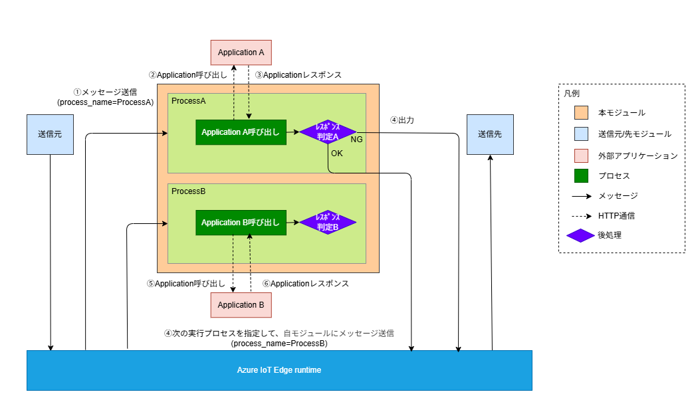
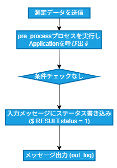
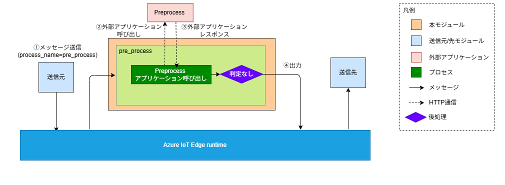
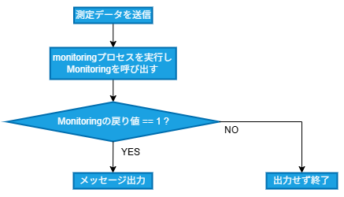
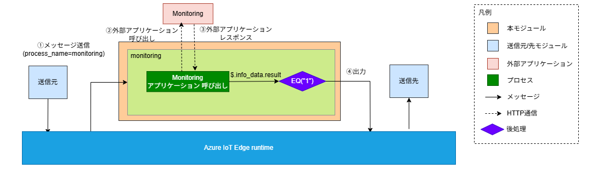
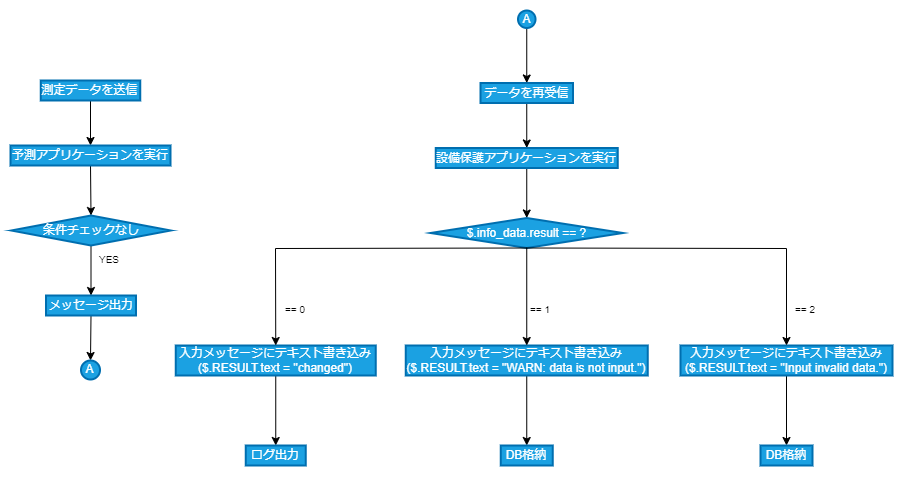
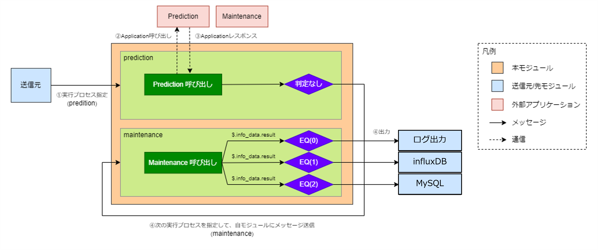

# ApplicationController

## 目次
* [概要](#概要)
* [機能](#機能)
* [Quick Start](#quick-start)
* [イメージのURL](#イメージのurl)
* [動作保証環境](#動作保証環境)
* [Deployment 設定値](#deployment-設定値)
  * [環境変数](#環境変数)
  * [Desired Properties](#desired-properties)
  * [Create Option](#create-option)
  * [startupOrder](#startuporder)
* [受信メッセージ](#受信メッセージ)
  * [Message Body](#message-body)
  * [Message Properties](#message-properties)
* [Http Application実行](#http-application実行)
  * [リクエスト](#リクエスト)
  * [レスポンス](#レスポンス)
* [送信メッセージ](#送信メッセージ)
  * [Message Body](#SendMessageBody)
  * [Message Properties](#SendMessageProperties)
* [Direct Method](#direct-method)
  * [SetLogLevel](#setloglevel)
  * [GetLogLevel](#getloglevel)
* [ログ出力内容](#ログ出力内容)
* [ユースケース](#ユースケース)
  * [ケース ①](#Usecase1)
  * [ケース ②](#Usecase2)
  * [ケース ③](#Usecase3)
* [Feedback](#Feedback)
* [LICENSE](#LICENSE)

## 概要

ApplicationControllerは、メッセージ受信をトリガに、事前に設定されたプロセスを実行し、結果を出力するAzure IoT edgeモジュールです。

## 機能

ApplicationControllerは、受信メッセージに基づきプロセス実行・外部アプリケーション連携・レスポンス処理を行う。  
処理の流れは下記の通り。  
① 受信メッセージのプロパティで指定されたプロセスを実行する。  
② プロセスから外部アプリケーションを呼び出す。  
③ 外部アプリケーションのレスポンスを受け取る。  
④ レスポンスを判定し、メッセージを送信する。その際に次に実行するプロセス名を指定して別のプロセスを再実行することも可能。  



## Quick Start
1. Personal Access tokenを作成
（参考: [個人用アクセス トークンを管理する](https://docs.github.com/ja/authentication/keeping-your-account-and-data-secure/managing-your-personal-access-tokens)）

2. リポジトリをクローン
```
git clone https://github.com/Project-GAUDI/ApplicationController.git
```

3. ./src/nuget_template.configの<GITHUB_USERNAME>と<PERSONAL_ACCESS_TOKEN>を自身のユーザー名とPersonal Access tokenに書き換えて、ファイル名をnuget.configに変更

4. Dockerイメージをビルド
```
docker image build -t <IMAGE_NAME> ./ApplicationController/src/
```
例）
```
docker image build -t ghcr.io/<YOUR_GITHUB_USERNAME>/applicationcontroller:<VERSION> ./ApplicationController/src/
```

5. Dockerイメージをコンテナレジストリにプッシュ
```
docker push <IMAGE_NAME>
```
例）
```
docker push ghcr.io/<YOUR_GITHUB_USERNAME>/applicationcontroller:<VERSION>
```

6. Azure IoT edgeで利用

## イメージのURL
準備中
| URL                                                             | Description         |
| --------------------------------------------------------------- | ------------------- |

## 動作保証環境

| Module Version | IoTEdge | edgeAgent | edgeHub | amd64 verified on | arm64v8 verified on | arm32v7 verified on |
| -------------- | ------- | --------- | ------- | ----------------- | ------------------- | ------------------- |
| 7.0.1          | 1.6.4   | 1.6.4     | 1.6.4   | ubuntu24.04       | －                  | －                  |

## Deployment 設定値

### 環境変数

#### 環境変数の値

| Key               | Type   | Required | Conditions                                  | Default | Description                           |
| ----------------- | ------ | -------- | ------------------------------------------- | ------- | ------------------------------------- |
| TransportProtocol | string |          | ["Amqp", "Mqtt"]                            | Amqp    | ModuleClient の接続プロトコル。       |
| LogLevel          | string |          | ["trace", "debug", "info", "warn", "error"] | info    | 出力ログレベル。                      |
| HttpTimeout       | number |          | 1以上の整数                                 | 10      | http 通信時のタイムアウト時間（秒）。 |

### Desired Properties

#### Desired Properties の値

| JSON Key                            | Type         | Required | Conditions                                           | Default | Description                                                                                                                                                                                                                                                                          |
| ----------------------------------- | ------------ | -------- | ---------------------------------------------------- | ------- | ------------------------------------------------------------------------------------------------------------------------------------------------------------------------------------------------------------------------------------------------------------------------------------ |
| input_name                          | string       | ○        |                                                      |         | メッセージの入力トピック名。                                                                                                                                                                                                                                                         |
| processes                           | object array | ○        |                                                      |         | プロセス設定配列。                                                                                                                                                                                                                                                                   |
| &emsp; process_name                 | string       | ○        |                                                      |         | 実行プロセス名。<br>受信メッセージの"process_name"プロパティにマッチした名前のプロセスを実行。                                                                                                                                                                                       |
| &emsp; application                  | object       | ○        |                                                      |         | 実行アプリケーション設定。                                                                                                                                                                                                                                                           |
| &emsp;&emsp; type                   | string       |          | ["http"]                                             | http    | プロトコルタイプ。                                                                                                                                                                                                                                                                   |
| &emsp;&emsp; url                    | string       | ○        |                                                      |         | 呼び出す外部アプリケーションのURL。<br>replace_paramsで部分置換可能。                                                                                                                                                                                                                |
| &emsp;&emsp; replace_params         | object array |          |                                                      |         | URLの文字置換パラメータ配列。                                                                                                                                                                                                                                                        |
| &emsp;&emsp;&emsp; base_name        | string       | △        | replace_params 指定時必須<br>urlに含まれる必要がある |         | 置換元文字列。                                                                                                                                                                                                                                                                       |
| &emsp;&emsp;&emsp; source_data_type | string       | △        | replace_params 指定時必須<br>["Body", "Properties"]  |         | 受信メッセージから取り出す置換文字列取得元。                                                                                                                                                                                                                                         |
| &emsp;&emsp;&emsp; source_data_key  | string       | △        | replace_params 指定時必須                            |         | 取得元データパス。source_data_typeが"Body"の場合はJSONPath※1、"Properties"の場合はプロパティ名を指定。                                                                                                                                                                               |
| &emsp; post_processes               | object array |          |                                                      |         | 後処理設定配列。<br>condition_pathとcondition_operatorが指定されている場合、指定された条件を満たせばtasksを実行する。<br>condition_pathとcondition_operatorが指定されていない場合、無条件でtasksを実行する。                                                                         |
| &emsp;&emsp; condition_path         | string       | △        | condition_operator 指定時必須                        |         | 実行条件元データパス。 (JSONPath※1)                                                                                                                                                                                                                                                  |
| &emsp;&emsp; condition_operator     | string       | △        | condition_path 指定時必須                            |         | 実行条件構文。※2                                                                                                                                                                                                                                                                     |
| &emsp;&emsp; tasks                  | object array | △        | post_processes 指定時必須                            |         | タスク設定配列。                                                                                                                                                                                                                                                                     |
| &emsp;&emsp;&emsp; output_name      | string       | △        | tasks 指定時必須                                     |         | メッセージの出力トピック名。                                                                                                                                                                                                                                                         |
| &emsp;&emsp;&emsp; next_process     | string       |          |                                                      |         | 次実行プロセス名。<br>次実行プロセスをMessage Propertiesのprocess_nameに指定し、メッセージ送信する。<br>送信を本モジュールにルーティングする事で、次プロセスが実行可能となる。                                                                                                       |
| &emsp;&emsp;&emsp; set_values       | object array |          |                                                      |         | 出力に設定するデータ配列。                                                                                                                                                                                                                                                           |
| &emsp;&emsp;&emsp;&emsp; type       | string       | △        | set_values 指定時必須<br>["Body", "Properties"]      |         | 出力先。                                                                                                                                                                                                                                                                             |
| &emsp;&emsp;&emsp;&emsp; key        | string       | △        | set_values 指定時必須                                |         | 出力先。typeが"Body"の場合はJSONPath※1、"Properties"の場合はプロパティ名を指定。<br>※参照データが存在しない場合や、JSONPath抽出で0件（該当データなし）の場合は、エラーや異常ではなく正常系の分岐として扱われる。<br>空データや空文字で処理を継続し、エラーや警告ログは出力されない。 |
| &emsp;&emsp;&emsp;&emsp; value      | string       | △        | set_values 指定時必須                                |         | 出力設定データ。                                                                                                                                                                                                                                                                     |

※1 JSONPath

* 記法
  [https://github.com/json-path/JsonPath#operators (外部リンク)](https://github.com/json-path/JsonPath#operators)
* 制限
  ".." や "[ \* ]" による複数の対象を指定することはできない

※2 実行条件構文

以下のものが使用可能

| 構文  | 説明                           |
| ----- | ------------------------------ |
| EQ(A) | A と一致するデータを取得する。 |

> **注意**: set_valuesで参照データが存在しない場合や、JSONPath抽出で0件（該当データなし）の場合は、エラーや異常ではなく正常系の分岐として扱われます。空データや空文字で処理を継続し、エラーや警告ログは出力されません。

#### Desired Properties の記入例

```json
{
  "input_name": "input",
  "processes": [
    {
      "process_name": "pre_process",
      "application": {
        "type": "http",
        "url": "http://Preprocess-<machinenumber>-<dienumber>:5001/score",
        "replace_params": [
          {
            "base_name": "<machinenumber>",
            "source_data_type": "Body",
            "source_data_key": "$.target.machinenumber"
          },
          {
            "base_name": "<dienumber>",
            "source_data_type": "Properties",
            "source_data_key": "die_number"
          }
        ]
      },
      "post_processes": [
        {
          "condition_path": "info_data/result",
          "condition_operator": "EQ(\"9\")",
          "tasks": [
            {
              "output_name": "out_view1",
              "next_process": "monitoring",
              "set_values": [
                {
                  "type": "Body",
                  "key": "$.RESULT.status",
                  "value": "10"
                }
              ]
            }
          ]
        }
      ]
    }
  ]
}
```

### Create Option

#### Create Option の値

なし

#### Create Option の記入例

```json
{}
```

### startupOrder

#### startupOrder の値

| JSON Key     | Type   | Required | Conditions                   | Default    | Recommend | Description                                            |
| ------------ | ------ | -------- | ---------------------------- | ---------- | --------- | ------------------------------------------------------ |
| startupOrder | number |          | 0 以上 4294967295 以下の整数 | 4294967295 | 400       | モジュールの起動順序。数字が小さいほど先に起動される。 |

#### startupOrder の記入例

```json
{
  "startupOrder": 400
}
```

## 受信メッセージ

### Message Body

任意のJSON形式データ。  
実行アプリケーションの入力データとして使用。

### Message Properties

| Key          | Description    |
| ------------ | -------------- |
| process_name | 実行プロセス名 |

### Message の例

```json
{
  "Body": {
    "RecordList": [
      {
        "RecordHeader": [
          "test_01.csv",
          "1"
        ],
        "RecordData": [
          "2",
          "5"
        ]
      }
    ],
    "target": {
      "machinenumber": "2"
    }
  },
  "Properties": {
    "process_name": "pre_process",
    "die_number": "5"
  }
}
```

## Http Application実行

### リクエスト

以下の手順でurlを決定し、Http Applicationを実行する。  
① モジュールツインのprocessesから"process_name"が受信メッセージのMessage Propertiesの"process_name"と一致する"プロセス設定"を選択。  
② ①の実行アプリケーション("application")の"url"と"replace_params"を取り出し、"replace_params"の設定に従い、urlの文字列を変換する。  
③ ②のurlに対し、受信メッセージのBodyをリクエストデータとしてアクセスする。

#### HTTPリクエスト仕様

* HTTPメソッド: **POST**
* Content-Type: **application/json**

リクエストBodyはJSON形式で送信する。

#### リクエスト例(Body)

```json
{
  "RecordList": [
    {
      "RecordHeader": [
        "test_01.csv",
        "1"
      ],
      "RecordData": [
        "2",
        "5"
      ]
    }
  ],
  "target": {
    "machinenumber": "2"
  }
}
```

### レスポンス

任意のJSON形式データ。ただし下記が含まれること。  

* 後処理でステータスの判定がある場合、判定対象のデータ。
* 次実行プロセスの指定がある場合、次実行プロセスの入力データとして必要な情報。

#### レスポンス例(Body)

```json
{
  "info_data": {
    "result": "9"
  }
}
```

## 送信メッセージ

<a id="SendMessageBody"></a>

### Message Body

受信メッセージのBody・実行アプリケーションのレスポンスBody・モジュールツインのset_valuesで設定したkeyとvalue（type="Body"時のみ）を送信する。  
set_valuesで設定したkeyが、受信メッセージのBody・実行アプリケーションのレスポンスBodyに存在する場合、set_valuesで設定したvalueで上書きされる。

```json
  "Body": {
      <受信メッセージのBody> ,
      <実行アプリケーションのレスポンスBody>,
      <モジュールツインのset_valuesで指定したkey,value>
  }
  ```

<a id="SendMessageProperties"></a>

### Message Properties

受信メッセージのPropertiesとモジュールツインのset_valuesで設定したkeyとvalue（type="Properties"時のみ）を送信する。  
set_valuesで設定したkeyが、受信メッセージのPropertiesに存在する場合、set_valuesで設定したvalueで上書きされる。  
process_nameプロパティは、next_processが指定されている場合はその値で設定され、next_processが未指定の場合は削除される。

```json
  "Properties": {
      <受信メッセージのProperties> ,
      <モジュールツインのset_valuesで指定したkey,value>,
      <next_processで指定されたprocess_name>
  }
  ```

### Message の例

```json
{
  "Body": {
    "RecordList": [
      {
        "RecordHeader": [
          "test_01.csv",
          "1"
        ],
        "RecordData": [
          "2",
          "5"
        ]
      }
    ],
    "target": {
      "machinenumber": "2"
    },
    "info_data": {
      "result": "9"
    },
    "RESULT": {
      "status": "10"
    }
  },
  "Properties": {
    "process_name": "monitoring",
    "die_number": "5"
  }
}
```

## Direct Method

### SetLogLevel

* 機能概要

  実行中に一時的にLogLevelを変更する。<br>
  変更はモジュール起動中または有効時間を過ぎるまで有効。<br>

* payload

  | JSON Key      | Type    | Required | default | Description |
  | ------------- | ------- | -------- | -------- | ----------- |
  | EnableSec     | integer  | 〇       |          | 有効時間(秒)。<br>-1:無期限<br>0:リセット(環境変数LogLevel相当に戻る)<br>1以上：指定時間(秒)経過まで有効。  |
  | LogLevel      | string  | △       |          | EnableSec=0以外を指定時必須。指定したログレベルに変更する。<br>["trace", "debug", "info", "warn", "error"]  |

  １時間"trace"レベルに変更する場合の設定例

  ```json
  {
    "EnableSec": 3600,
    "LogLevel": "trace"
  }
  ```

* response

  | JSON Key      | Type    | Description |
  | ------------- | ------- | ----------- |
  | status          | integer | 処理ステータス。<br>0:正常終了<br>その他:異常終了         |
  | payload          | object  | レスポンスデータ。         |
  | &nbsp; CurrentLogLevel | string  | 設定後のログレベル。（正常時のみ）<br>["trace", "debug", "info", "warn", "error"]  |
  | &nbsp; Error | string  | エラーメッセージ（エラー時のみ）  |

  ```json
  {
    "status": 0,
    "paylaod":
    {
      "CurrentLogLevel": "trace"
    }
  }
  ```

### GetLogLevel

* 機能概要

  現在有効なLogLevelを取得する。<br>
  通常は、LogLevel環境変数の設定値が返り、SetLogLevelで設定した有効時間内の場合は、その設定値が返る。<br>

* payload

  なし

* response

  | JSON Key      | Type    | Description |
  | ------------- | ------- | ----------- |
  | status          | integer | 処理ステータス。<br>0:正常終了<br>その他:異常終了         |
  | payload          | object  | レスポンスデータ。         |
  | &nbsp; CurrentLogLevel | string  | 現在のログレベル。（正常時のみ）<br>["trace", "debug", "info", "warn", "error"]  |
  | &nbsp; Error | string  | エラーメッセージ（エラー時のみ）  |

  ```json
  {
    "status": 0,
    "paylaod":
    {
      "CurrentLogLevel": "trace"
    }
  }
  ```

## ログ出力内容

| LogLevel | 出力概要                                                                                                                                                                                 |
| -------- | ---------------------------------------------------------------------------------------------------------------------------------------------------------------------------------------- |
| error    | [初期化/リソース解放/モジュールツイン更新/メッセージ送信/メッセージ受信]失敗<br>[環境変数/モジュールツイン]の必須項目未設定<br>[環境変数/モジュールツイン]がConditionsまたはType制約違反 |
| warn     | エッジランタイムとの接続リトライ失敗                                                                                                                                                     |
| info     | [環境変数/モジュールツイン]の値<br>モジュールツイン更新通知<br>[環境変数/モジュールツイン]の省略可能項目未設定のためDefault値適用<br>メッセージ[送信/受信]通知                           |
| debug    | 無し                                                                                                                                                                                     |
| trace    | リソース解放済み通知<br>メソッドの開始・終了<br>受信メッセージBody                                                                                                                       |

## ユースケース

<a id="Usecase1"></a>

### ケース ①

測定データを送信して前処理アプリケーションを実行する。受信メッセージに処理ステータスを付与して送信する。  




#### 起動順序 startupOrder

| 名称         | 値  |
| ------------ | --- |
| startupOrder | 400 |

#### 環境変数

| 名称              | 値    |
| ----------------- | ----- |
| TransportProtocol | Amqp  |
| LogLevel          | debug |
| HttpTimeout       | 10    |

#### コンテナーの作成オプション Create Option

```json
{}
```

#### モジュールツインの設定

```json
{
  "input_name": "input",
  "processes": [
    {
      "process_name": "pre_process",
      "application": {
        "type": "http",
        "url": "http://Preprocess-<value1>-<value2>:5001/score",
        "replace_params": [
          {
            "base_name": "<value1>",
            "source_data_type": "Body",
            "source_data_key": "$.RecordList[0].RecordData[0]"
          },
          {
            "base_name": "<value2>",
            "source_data_type": "Body",
            "source_data_key": "$.RecordList[0].RecordData[1]"
          }
        ]
      },
      "post_processes": [
        {
          "tasks": [
            {
              "output_name": "output1",
              "set_values": [
                {
                  "type": "Body",
                  "key": "$.RESULT.status",
                  "value": "1"
                }
              ]
            }
          ]
        }
      ]
    }
  ]
}
```

#### 受信メッセージ

```json
{
  "Body": {
    "RecordList": [
      {
        "RecordHeader": [
          "test_01.csv",
          "1"
        ],
        "RecordData": [
          "2",
          "5"
        ]
      }
    ]
  },
  "Properties": {
    "process_name": "pre_process"
  }
}
```

#### Http Application実行のリクエスト

* HTTPメソッド: **POST**
* Content-Type: **application/json**
* URL: `http://Preprocess-2-5:5001/score`

リクエストBody

```json
{
  "RecordList": [
    {
      "RecordHeader": [
        "test_01.csv",
        "1"
      ],
      "RecordData": [
        "2",
        "5"
      ]
    }
  ]
}
```

#### Http Application実行のレスポンス

```json
{
  "info_data": {
    "result": "1"
  }
}
```

#### 送信メッセージ

output トピック名: "output1"

```json
{
  "Body": {
    "RecordList": [
      {
        "RecordHeader": [
          "test_01.csv",
          "1"
        ],
        "RecordData": [
          "2",
          "5"
        ]
      }
    ],
    "info_data": {
      "result": "1"
    },
    "RESULT": {
      "status": "1"
    }
  },
  "Properties": {}
}
```

<a id="Usecase2"></a>

### ケース ②

測定データを送信して監視アプリケーションを実行する。アプリケーションの戻り値が"1"の場合のみ、メッセージを送信する。




#### 起動順序 startupOrder

| 名称         | 値  |
| ------------ | --- |
| startupOrder | 400 |

#### 環境変数

| 名称              | 値    |
| ----------------- | ----- |
| TransportProtocol | Amqp  |
| LogLevel          | debug |
| HttpTimeout       | 10    |

#### コンテナーの作成オプション Create Option

```json
{}
```

#### モジュールツインの設定

```json
{
  "input_name": "input",
  "processes": [
    {
      "process_name": "monitoring",
      "application": {
        "type": "http",
        "url": "http://Monitoring-<value1>:5001",
        "replace_params": [
          {
            "base_name": "<value1>",
            "source_data_type": "Body",
            "source_data_key": "$.RecordList[0].RecordData[0]"
          }
        ]
      },
      "post_processes": [
        {
          "condition_path": "$.info_data.result",
          "condition_operator": "EQ(\"1\")",
          "tasks": [
            {
              "output_name": "out_continue"
            }
          ]
        }
      ]
    }
  ]
}
```

#### 受信メッセージ

```json
{
  "Body": {
    "RecordList": [
      {
        "RecordHeader": [
          "test_01.csv",
          "1"
        ],
        "RecordData": [
          "2"
        ]
      }
    ]
  },
  "Properties": {
    "process_name": "monitoring"
  }
}
```

#### Http Application実行のリクエスト

* HTTPメソッド: **POST**
* Content-Type: **application/json**
* URL: `http://Monitoring-2:5001`

リクエストBody

```json
{
  "RecordList": [
    {
      "RecordHeader": [
        "test_01.csv",
        "1"
      ],
      "RecordData": [
        "2"
      ]
    }
  ]
}
```

#### Http Application実行のレスポンス

```json
{
  "info_data": {
    "result": "1"
  }
}
```

#### 送信メッセージ

output トピック名: "out_continue"  
※後処理設定の条件によりレスポンスのinfo_data.resultが"1"以外の場合、メッセージは送信されない。

```json
{
  "Body": {
    "RecordList": [
      {
        "RecordHeader": [
          "test_01.csv",
          "1"
        ],
        "RecordData": [
          "2"
        ]
      }
    ],
    "info_data": {
      "result": "1"
    }
  },
  "Properties": {}
}
```

<a id="Usecase3"></a>

### ケース ③

測定データを送信して予測アプリケーションを実行し出力を自身のモジュールで受けなおし、設備保護アプリケーションを実行する。  
出力には設備保護アプリケーションの結果ごとのテキストをセットしてDBに格納する。




#### 起動順序 startupOrder

| 名称         | 値  |
| ------------ | --- |
| startupOrder | 400 |

#### 環境変数

| 名称              | 値    |
| ----------------- | ----- |
| TransportProtocol | Amqp  |
| LogLevel          | debug |
| HttpTimeout       | 10    |

#### コンテナーの作成オプション Create Option

```json
{}
```

#### モジュールツインの設定

```json
{
  "input_name": "input",
  "processes": [
    {
      "process_name": "prediction",
      "application": {
        "type": "http",
        "url": "http://Prediction-<value1>:5001",
        "replace_params": [
          {
            "base_name": "<value1>",
            "source_data_type": "Body",
            "source_data_key": "$.RecordList[0].RecordData[0]"
          }
        ]
      },
      "post_processes": [
        {
          "tasks": [
            {
              "output_name": "out_continue",
              "next_process": "maintenance"
            }
          ]
        }
      ]
    },
    {
      "process_name": "maintenance",
      "application": {
        "type": "http",
        "url": "http://Maintenance:5001"
      },
      "post_processes": [
        {
          "condition_path": "$.info_data.result",
          "condition_operator": "EQ(\"0\")",
          "tasks": [
            {
              "output_name": "out_change1",
              "set_values": [
                {
                  "type": "Body",
                  "key": "$.RESULT.text",
                  "value": "changed"
                }
              ]
            }
          ]
        },
        {
          "condition_path": "$.info_data.result",
          "condition_operator": "EQ(\"1\")",
          "tasks": [
            {
              "output_name": "out_alert1",
              "set_values": [
                {
                  "type": "Body",
                  "key": "$.RESULT.text",
                  "value": "WARN: data is not input."
                }
              ]
            }
          ]
        },
        {
          "condition_path": "$.info_data.result",
          "condition_operator": "EQ(\"2\")",
          "tasks": [
            {
              "output_name": "out_alert2",
              "set_values": [
                {
                  "type": "Body",
                  "key": "$.RESULT.text",
                  "value": "Invalid data."
                }
              ]
            }
          ]
        }
      ]
    }
  ]
}
```

##### ルート設定

```json
{
  "input1": "FROM /messages/modules/送信元/outputs/output INTO BrokeredEndpoint(\"/modules/ApplicationController/inputs/input\")",
  "reInput1": "FROM /messages/modules/ApplicationController/outputs/out_continue INTO BrokeredEndpoint(\"/modules/ApplicationController/inputs/input\")",
  "output1": "FROM /messages/modules/ApplicationController/outputs/out_change1 INTO BrokeredEndpoint(\"/modules/Logger/inputs/input\")",
  "output2": "FROM /messages/modules/ApplicationController/outputs/out_alert1 INTO BrokeredEndpoint(\"/modules/InfluxDBRegister/inputs/input\")",
  "output3": "FROM /messages/modules/ApplicationController/outputs/out_alert2 INTO BrokeredEndpoint(\"/modules/MySQLRegister/inputs/input\")"
}
```

#### 処理の流れ例

##### 受信メッセージ

```json
{
  "Body": {
    "RecordList": [
      {
        "RecordHeader": [
          "test_01.csv",
          "1"
        ],
        "RecordData": [
          "2"
        ]
      }
    ]
  },
  "Properties": {
    "process_name": "prediction"
  }
}
```

##### predictionプロセス: Http Application実行のリクエスト

* HTTPメソッド: **POST**
* Content-Type: **application/json**
* URL: `http://Prediction-2:5001`

リクエストBody

```json
{
  "RecordList": [
    {
      "RecordHeader": [
        "test_01.csv",
        "1"
      ],
      "RecordData": [
        "2"
      ]
    }
  ]
}
```

##### predictionプロセス: Http Application実行のレスポンス

url: `http://Prediction-2:5001` のレスポンス例

```json
{
  "info_data": {
    "result": "1"
  }
}
```

##### 送信メッセージ①（受信メッセージ②）

output トピック名: "out_continue"

```json
{
  "Body": {
    "RecordList": [
      {
        "RecordHeader": [
          "test_01.csv",
          "1"
        ],
        "RecordData": [
          "2"
        ]
      }
    ],
    "info_data": {
      "result": "1"
    }
  },
  "Properties": {
    "process_name": "maintenance"
  }
}
```

##### maintenanceプロセス: Http Application実行のリクエスト

predictionのレスポンスを受けて、maintenanceプロセスが実行される。

* HTTPメソッド: **POST**
* Content-Type: **application/json**
* URL: `http://Maintenance:5001`

リクエストBody（predictionのレスポンスと同じデータが送信される想定）

```json
{
  "RecordList": [
    {
      "RecordHeader": [
        "test_01.csv",
        "1"
      ],
      "RecordData": [
        "2"
      ]
    }
  ],
  "info_data": {
    "result": "1"
  }
}
```

##### maintenanceプロセス: Http Application実行のレスポンス

url: `http://Maintenance:5001` のレスポンス例

```json
{
  "info_data": {
    "result": "2"
  }
}
```

##### 送信メッセージ②

output トピック名: "out_alert2"

```json
{
  "Body": {
    "RecordList": [
      {
        "RecordHeader": [
          "test_01.csv",
          "1"
        ],
        "RecordData": [
          "2"
        ]
      }
    ],
    "info_data": {
      "result": "2"
    },
    "RESULT": {
      "text": "Invalid data."
    }
  },
  "Properties": {}
}
```

後処理設定の条件を満たさないため、output トピック名: "out_change1", "out_alert1"のメッセージは送信されない。

## Feedback
お気づきの点があれば、ぜひIssueにてお知らせください。

## LICENSE
ApplicationController is licensed under the MIT License, see the [LICENSE](LICENSE) file for details.
